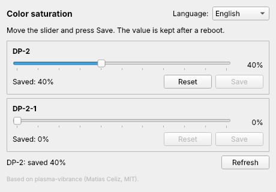

# Vivid

**Color saturation ("digital vibrance") per monitor for KDE Plasma 6 on Wayland.**
The saturation slider AMD Adrenalin and the NVIDIA control panel give you on Windows,
for regular (non-HDR) monitors on Linux. No terminal needed.



> **Based on [plasma-vibrance](https://github.com/Celiz/plasma-vibrance) by
> [Matias Celiz](https://github.com/Celiz).** The color science (the synthetic ICC
> profile) and the way it is enabled through KWin are his work. Vivid wraps it in a
> simple app. Thank you, Matias!

## Install

1. Download **Vivid-x86_64.AppImage** from the [Releases](../../releases/latest) page.
2. Double-click it. If Plasma asks whether to make it executable, say yes.
   (Or: right-click → Properties → Permissions → *Is executable*.)
3. Move the slider for your monitor and press **Save**.

That's it. The value stays after a reboot and nothing runs in the background, so you
can close the app. After the first launch Vivid also appears in your application menu.

Tip: keep the AppImage somewhere permanent (for example `~/Applications`). If you move
it, just start it once from the new place and the menu entry follows.

## Features

- finds all your monitors and shows their real model names;
- one slider, **Save** and **Reset** per monitor;
- English, Ukrainian and Russian interface;
- picks up values set earlier with plasma-vibrance.

## Requirements

- KDE Plasma 6.1 or newer, Wayland session
- any GPU (AMD, Intel, NVIDIA)

## How it works

Vivid builds a synthetic ICC profile (ICC v2 with a lut16 `B2A` tag) that applies the
saturation matrix in gamma space, the same way the Windows drivers do, and enables it
for that monitor with `kscreen-doctor`. KWin remembers the profile, so nothing has to
keep running. Profiles live in `~/.local/share/color/icc/vibrance-<output>-<pct>.icc`.

Saving a value above 0% switches the monitor's color power preference to
**prefer color accuracy**, because only in that mode does KWin apply the profile's 3D
table. It costs one extra full-screen pass per frame, which is negligible on a desktop
GPU. **Reset** returns the monitor to sRGB and *prefer efficiency*.

Known limits:

- Reset sets the monitor to the default sRGB profile. If you had your own ICC profile
  on that monitor before, set it again in System Settings → Display.
- The profile is bound to the connector name (e.g. `DP-2`). If you plug the monitor into
  another port, set the value again.
- Apps that do their own color management may bypass the effect.

## Uninstall

Press **Reset** for each monitor, then delete the AppImage and
`~/.local/share/applications/vivid.desktop`.

## Build from source

```bash
pip install PySide6-Essentials pyinstaller
python3 vivid.py                     # run
bash packaging/build-appimage.sh     # build dist/Vivid-x86_64.AppImage (needs appimagetool)
```

Pushing a `v*` tag (or running the "Build AppImage" workflow with a version) builds the AppImage with GitHub Actions and attaches it to the release.

---

## Українською

**Vivid** — повзунок насиченості кольору для кожного монітора в KDE Plasma 6 (Wayland),
як «Насиченість» в AMD Adrenalin чи «Digital Vibrance» в NVIDIA на Windows.

**Встановлення:** скачайте `Vivid-x86_64.AppImage` зі сторінки
[Releases](../../releases/latest), двічі клацніть по ньому (якщо Plasma спитає, дозвольте
зробити файл виконуваним), посуньте повзунок і натисніть **Save / Зберегти**. Значення
лишається після перезавантаження, у фоні нічого не працює. Мову можна змінити у правому
верхньому куті.

В основі — [plasma-vibrance](https://github.com/Celiz/plasma-vibrance) від
**Matias Celiz** (MIT).

---

## Credits and license

- [plasma-vibrance](https://github.com/Celiz/plasma-vibrance) © 2026 Matias Celiz, MIT
- Vivid © 2026 Bayashem, MIT
- Built with [Claude Code](https://claude.com/claude-code)

See [LICENSE](LICENSE).
